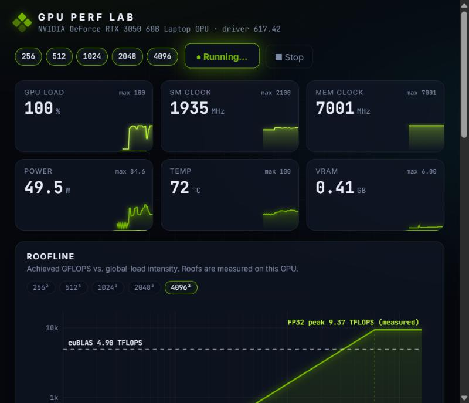
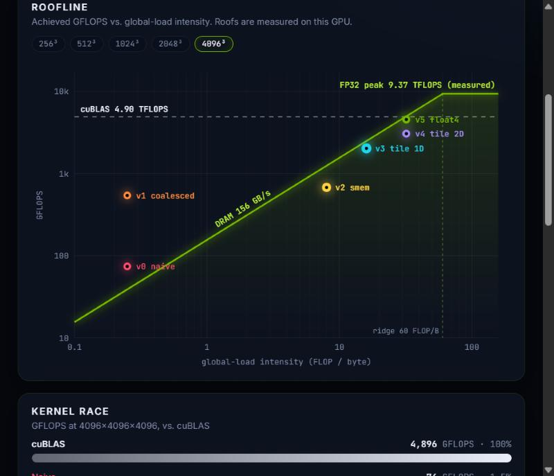
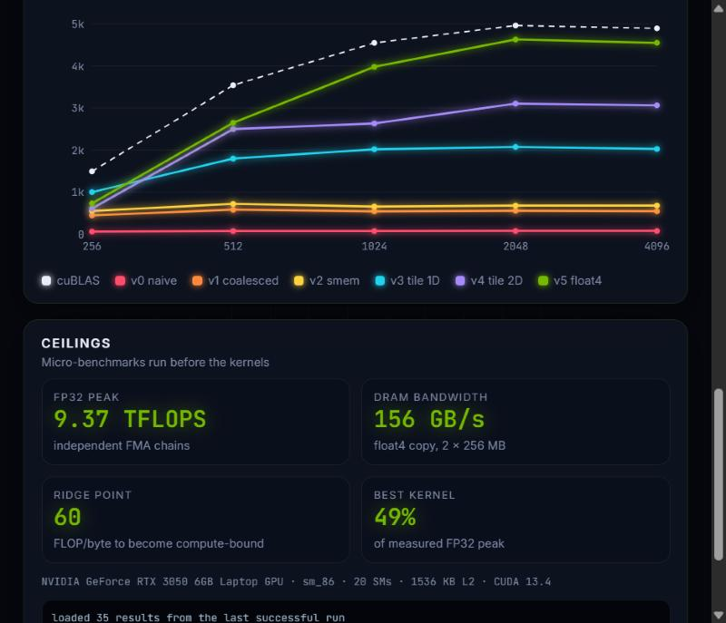

# GPU Perf Lab

Hand-written CUDA matrix-multiply (SGEMM) kernels, optimized step by step from a
naive kernel to **94% of cuBLAS**. An animated dashboard runs them live, places
them on a measured roofline, and streams GPU telemetry while they run.



## Results

RTX 3050 6 GB Laptop GPU (Ampere, sm_86, 20 SMs), CUDA 13.4, FP32, 4096 x 4096 x 4096.
Every kernel is checked against cuBLAS (max relative error 3.4e-6).

| Kernel | Idea | GFLOPS | vs. cuBLAS | Speedup vs. naive |
|---|---|--:|--:|--:|
| v0 naive | one thread per output | 74 | 1.4% | 1x |
| v1 coalesced | a warp touches 32 consecutive floats | 564 | 10.7% | 7.6x |
| v2 shared memory | 32x32 tiles staged in shared memory | 679 | 12.9% | 9.1x |
| v3 1D register tiling | 8 outputs per thread | 2,169 | 41.0% | 29x |
| v4 2D register tiling | 8x8 outer product per thread | 3,174 | 60.1% | 43x |
| **v5 vectorized** | float4 loads, transposed A tile | **4,986** | **94.3%** | **67x** |
| cuBLAS | | 5,285 | 100% | |

Measured ceilings (micro-benchmarks in [`src/probes.cuh`](src/probes.cuh)):
**9.55 TFLOPS** FP32 FMA peak and **156 GB/s** DRAM bandwidth, giving a ridge point of
about 61 FLOP/byte. v5 reaches 52% of the FP32 peak; cuBLAS reaches 55%.

Raw output: [`results/rtx3050-laptop.jsonl`](results/rtx3050-laptop.jsonl). A
second run with the GPU already warm (72 °C) came out 3–9% lower across the
board. On a laptop, thermal state matters.



## What each step fixes

**v0 → v1: memory coalescing (7.6x).** In v0, `threadIdx.x` walks down rows, so
the 32 threads of a warp read 32 different rows of A and write 32 different rows
of C. Each access is its own memory transaction. Swapping the mapping so
consecutive threads own consecutive *columns* turns a warp's B loads and C stores
into single 128-byte transactions, and its A load into one broadcast. The math
is unchanged.

**v1 → v2: shared-memory tiling (1.2x).** Each block stages 32x32 tiles of A and B
in shared memory and reuses each value 32 times. The gain is smaller than expected
because v1 was already getting much of that reuse from the L1/L2 caches. That's
why v1 sits *above* the DRAM roof on the chart.

**v2 → v3: 1D register tiling (3.2x).** v2 does two shared-memory loads per FMA, so
it is bound by shared-memory bandwidth, not math. Having each thread compute 8
outputs in a column lets one value of B, held in a register, feed 8 FMAs.

**v3 → v4: 2D register tiling (1.5x).** Each thread computes an 8x8 outer product:
16 shared loads feed 64 FMAs. The cost is register pressure. `ptxas` reports
**145 registers/thread**, so only one 256-thread block fits per SM.

**v4 → v5: vectorized loads (1.6x).** Global memory is moved as `float4` (16-byte)
loads and stores, and the A tile is stored transposed in shared memory so the
inner loop reads it contiguously. As a side effect, register use drops to **103**,
so two blocks fit per SM and occupancy doubles.

## Things the data shows

- **v5 beats cuBLAS at 512³ (111%).** cuBLAS's heuristics pick a kernel tuned for
  general shapes, and at small sizes a single fixed tiling can win.
- **v4 is *slower* than v3 at 256³.** A 256x256 output with 128x128 tiles is only
  **4 blocks for 20 SMs**, so 80% of the GPU sits idle. v3's 64x64 tiles make 16
  blocks. Big tiles need big problems.
- **Naive is flat at ~74 GFLOPS at every size.** It's limited by uncoalesced
  memory traffic, not by the amount of work.



## The roofline, and what "intensity" means here

The x-axis is **global-load intensity**: FLOPs per byte the kernel *requests* from
global memory, derived from its tiling. A BMxBN output tile loads (BM + BN)·K
floats for 2·BM·BN·K FLOPs, so intensity = BM·BN / (2·(BM+BN)): 0.25 for v0/v1,
8 for 32x32 tiles, 16 for 64x64, and 32 for 128x128.

It's a model, not a hardware counter. Caches serve repeated requests, so real DRAM
traffic is lower, and kernels like v1 can sit above the DRAM roof. Measuring true
DRAM bytes needs Nsight Compute (`ncu --metrics dram__bytes_read.sum`), which on
Windows requires enabling GPU performance-counter access for non-admin users.

## Dashboard

- **Live telemetry** via NVML at 4 Hz: GPU load, SM and memory clocks, power,
  temperature and VRAM, as glowing sparklines.
- **Animated roofline:** roofs come from the probes, and each kernel flies to its
  measured point with a trail and a shockwave as its result arrives. Hover a
  point for details.
- **Kernel race:** GFLOPS bars against cuBLAS at the selected size.
- **Size sweep:** GFLOPS as N grows, per kernel.

The benchmark prints one JSON line per result. The FastAPI server pipes them to
the browser over server-sent events, so results appear as each kernel finishes.
Charts are hand-written Canvas 2D with no chart library.

## Build & run

Requirements: an NVIDIA GPU, the [CUDA Toolkit](https://developer.nvidia.com/cuda-downloads)
(12+), and on Windows the Visual Studio Build Tools with "Desktop development with C++".

```bash
build.bat                       # Windows: finds MSVC itself, builds for this GPU (-arch=native)
# or: cmake -B build && cmake --build build --config Release

build\gemm_bench.exe                              # all kernels, sizes 256..4096
build\gemm_bench.exe --sizes 1024 --kernels v5_vectorized
```

```bash
python -m venv .venv && .venv\Scripts\activate
pip install -r lab/requirements.txt
python -m lab.server            # http://127.0.0.1:8100, then press "Run benchmark"
```

## Layout

```
src/kernels.cuh     the six SGEMM kernels + launch configs + registry
src/probes.cuh      FP32-peak and DRAM-bandwidth micro-benchmarks
src/gemm_bench.cu   timing (CUDA events, median), cuBLAS reference + correctness check, JSON output
lab/server.py       FastAPI: NVML telemetry thread, benchmark runner, SSE stream
lab/static/         dashboard (vanilla JS + Canvas)
results/            reference results from an RTX 3050 Laptop GPU
```

## Next steps

- **Async copies + double buffering** (`cp.async`, Ampere): overlap loading the
  next tile with computing the current one.
- **Warp tiling:** an extra level of tiling at warp granularity for better
  shared-memory bank behavior.
- **Autotuning** BM/BN/BK/TM/TN per size, which should fix the small-size cases.
- **Tensor Cores** (TF32 via WMMA / `mma.sync`) for an order-of-magnitude higher ceiling.

## Credits

The kernel progression follows Simon Boehm's excellent
[How to Optimize a CUDA Matmul Kernel for cuBLAS-like Performance](https://siboehm.com/articles/22/CUDA-MMM).
The probes, benchmark harness, roofline model, dashboard and all measurements are
specific to this project.
